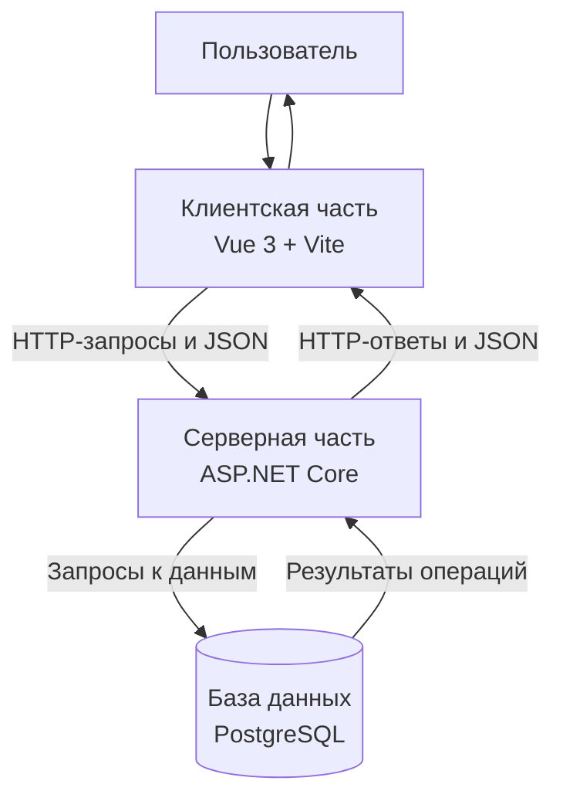

# Архитектура веб-системы согласования заявок на оплату

Курс: Б1.В.ДЭ.01.02.02 · КГЭУ · семестр 1 · 2026/2027 Студент: Суржиков Никита Группа: ТРИС-3-23 Дата: 18.10.2026

## 1. Назначение архитектуры

Архитектура описывает структуру веб-системы согласования заявок на оплату и взаимодействие её основных компонентов.

Система использует клиент-серверную архитектуру. Клиентская часть предоставляет пользовательский интерфейс, серверная часть обрабатывает запросы и проверяет права доступа, а база данных обеспечивает постоянное хранение информации.

## 2. Используемые технологии

| Компонент | Технология | Назначение |
|---|---|---|
| Клиентская часть | Vue 3 | Отображение интерфейса и взаимодействие с пользователем |
| Инструмент сборки клиента | Vite | Запуск и сборка клиентского приложения |
| Серверная часть | ASP.NET Core | Обработка HTTP-запросов, проверка данных и прав доступа |
| База данных | PostgreSQL | Хранение заявок, контрагентов и пользователей |
| Формат обмена | JSON | Передача данных между клиентом и сервером |
| Протокол обмена | HTTP | Передача запросов и ответов |

## 3. Архитектурная схема

## 4. Клиентская часть

Клиентская часть разрабатывается с использованием Vue 3 и Vite.

Она отвечает за:

- отображение списка заявок;
- отображение подробной информации о заявке;
- создание заявки;
- выбор контрагента из справочника;
- отображение текущего статуса;
- отображение действий, доступных пользователю;
- отправку запросов на сервер;
- отображение результатов операций и сообщений об ошибках.

Клиентская часть не подключается напрямую к PostgreSQL. Все операции с данными выполняются через серверное API.

Скрытие недоступных действий в интерфейсе улучшает удобство использования, но не заменяет серверную проверку прав.

## 5. Серверная часть

Серверная часть разрабатывается с использованием ASP.NET Core.

Она отвечает за:

- приём HTTP-запросов;
- проверку входных данных;
- аутентификацию пользователей;
- проверку ролей и разрешений;
- создание заявок;
- назначение исполнителей;
- изменение статусов;
- проверку допустимости переходов между статусами;
- взаимодействие с PostgreSQL;
- формирование ответов в формате JSON.

Сервер является основным компонентом, который обеспечивает соблюдение бизнес-правил системы.

## 6. База данных

Для хранения информации используется PostgreSQL.

База данных содержит три основные таблицы:

- `PaymentRequest` — заявки на оплату;
- `Counterparty` — контрагенты;
- `User` — пользователи.

Таблицы связаны первичными и внешними ключами. Это позволяет хранить ссылки на контрагентов, создателей заявок и назначенных исполнителей.

База данных обеспечивает сохранность информации после перезапуска приложения.

## 7. Основной сценарий взаимодействия

Рассмотрим создание заявки на оплату.

1. Менеджер открывает форму создания заявки в клиентском приложении.
2. Клиент получает список контрагентов с помощью запроса `GET /api/counterparties`.
3. Менеджер вводит название, описание, сумму и выбирает контрагента.
4. Клиент отправляет запрос `POST /api/payment-requests`.
5. Сервер проверяет авторизацию, права пользователя и корректность данных.
6. Сервер сохраняет новую заявку в PostgreSQL со статусом `New`.
7. Сервер возвращает созданную заявку в формате JSON.
8. Клиент отображает результат операции.

Если данные некорректны или пользователь не имеет необходимых прав, сервер возвращает соответствующую ошибку.

## 8. Безопасность и разграничение доступа

Доступ к операциям определяется ролью пользователя.

- Менеджер может создавать заявки и просматривать доступные ему данные.
- Руководитель отдела может просматривать заявки для согласования и назначать директора.
- Директор может работать с назначенными ему заявками и изменять их статусы в рамках разрешённых переходов.

Сервер проверяет права при каждом защищённом запросе. Нельзя полагаться только на скрытие кнопок в интерфейсе.

Пароли пользователей не должны храниться в открытом виде. При реализации авторизации необходимо использовать безопасное хранение паролей и защищённую конфигурацию приложения.

## 9. Вывод

В результате определена архитектура веб-системы согласования заявок на оплату. Система состоит из клиентской части на Vue 3, серверной части на ASP.NET Core и базы данных PostgreSQL. Каждый компонент выполняет отдельные задачи, а обмен данными между клиентом и сервером осуществляется через HTTP API в формате JSON.
