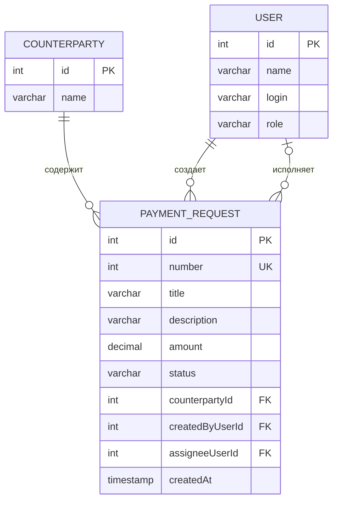

# Модель данных веб-системы согласования заявок на оплату

**Студент:** Суржиков Никита  
**Группа:** ТРИС-3-23  
**Лабораторная работа:** № 2

## 1. Назначение модели данных

Модель данных предназначена для хранения информации о заявках на оплату, контрагентах и пользователях системы.

Основная сущность системы — заявка на оплату (`PaymentRequest`). Она содержит информацию о назначении платежа, сумме, контрагенте, создателе, назначенном исполнителе и текущем статусе.

Для хранения данных используются три основные таблицы:

- `PaymentRequest` — заявки на оплату;
- `Counterparty` — справочник контрагентов;
- `User` — пользователи системы.

## 2. Таблица PaymentRequest

Таблица предназначена для хранения заявок на оплату.

| Поле | Тип данных | Обязательное | Описание |
|---|---|---|---|
| `id` | Integer | Да | Первичный ключ заявки |
| `number` | Integer | Да | Уникальный номер заявки для отображения пользователю |
| `title` | Varchar(80) | Да | Название заявки |
| `description` | Varchar(500) | Да | Описание назначения платежа |
| `amount` | Decimal(12,2) | Да | Сумма оплаты |
| `status` | Varchar(20) | Да | Текущий статус заявки |
| `counterpartyId` | Integer | Да | Внешний ключ контрагента |
| `createdByUserId` | Integer | Да | Внешний ключ создателя заявки |
| `assigneeUserId` | Integer | Нет | Внешний ключ назначенного исполнителя |
| `createdAt` | Timestamp | Да | Дата и время создания заявки |

Первичный ключ: `id`.

Внешние ключи:

- `counterpartyId` ссылается на `Counterparty.id`;
- `createdByUserId` ссылается на `User.id`;
- `assigneeUserId` ссылается на `User.id`.

Поле `number` используется для отображения номера заявки пользователю. Оно отличается от технического идентификатора `id`.

Допустимые значения поля `status`:

- `New` — новая заявка;
- `InProgress` — заявка находится в работе;
- `Closed` — заявка оплачена;
- `Cancelled` — заявка отклонена.

При создании заявки система автоматически формирует её идентификатор, уникальный номер, дату создания и статус `New`. Исполнитель на момент создания может отсутствовать.

## 3. Таблица Counterparty

Таблица предназначена для хранения справочника контрагентов, которым выполняются платежи.

| Поле | Тип данных | Обязательное | Описание |
|---|---|---|---|
| `id` | Integer | Да | Первичный ключ контрагента |
| `name` | Varchar(150) | Да | Название контрагента |

Первичный ключ: `id`.

Поле `name` содержит название организации или другого контрагента. В таблице заявок хранится ссылка на контрагента через `counterpartyId`, а не его название.

## 4. Таблица User

Таблица предназначена для хранения информации о пользователях системы.

| Поле | Тип данных | Обязательное | Описание |
|---|---|---|---|
| `id` | Integer | Да | Первичный ключ пользователя |
| `name` | Varchar(100) | Да | Имя пользователя |
| `login` | Varchar(100) | Да | Уникальный логин пользователя |
| `role` | Varchar(30) | Да | Роль пользователя |

Первичный ключ: `id`.

Поле `login` должно быть уникальным.

Допустимые роли:

- `Manager` — менеджер;
- `DepartmentHead` — руководитель отдела;
- `Director` — директор.

Пароли не хранятся в открытом виде в данной модели. При реализации авторизации для них необходимо использовать безопасное хеширование.

## 5. Связи между таблицами

Между таблицами существуют следующие связи:

1. `Counterparty` и `PaymentRequest`: один контрагент может быть связан с несколькими заявками. Каждая заявка ссылается на одного контрагента.
2. `User` и `PaymentRequest` через `createdByUserId`: один пользователь может создать несколько заявок. Каждая заявка имеет одного создателя.
3. `User` и `PaymentRequest` через `assigneeUserId`: один пользователь может быть назначен исполнителем нескольких заявок. У заявки может не быть назначенного исполнителя.

## 6. ER-диаграмма

Диаграмма показывает структуру основных таблиц, первичные и внешние ключи, а также связи между пользователями, контрагентами и заявками.

## 7. Проверка третьей нормальной формы

Модель данных проектируется с учётом требований третьей нормальной формы (3НФ).

В таблице `PaymentRequest` хранятся только данные, относящиеся непосредственно к заявке, а также ссылки на контрагента и пользователей.

Название контрагента хранится в таблице `Counterparty`. В заявке используется только поле `counterpartyId`. Это позволяет избежать повторного хранения одного и того же названия в нескольких заявках.

Данные пользователя хранятся в таблице `User`. В таблице заявок сохраняются ссылки на создателя и исполнителя. Поэтому имя пользователя и его логин не нужно повторять в каждой заявке.

При соблюдении указанных условий неключевые атрибуты зависят от ключа своей таблицы, а данные контрагентов и пользователей не дублируются в заявках.

Таким образом, выбранная структура соответствует основным принципам третьей нормальной формы.

## 8. Ограничения целостности данных

Для обеспечения корректности данных должны выполняться следующие условия:

1. Каждая заявка имеет уникальный `id`.
2. Каждая заявка имеет уникальный `number`.
3. Название заявки обязательно и содержит от 5 до 80 символов.
4. Описание заявки обязательно и содержит от 10 до 500 символов.
5. Сумма оплаты должна быть больше нуля.
6. Контрагент, создатель и назначенный исполнитель должны существовать в соответствующих таблицах.
7. Поле `assigneeUserId` может быть пустым до назначения исполнителя.
8. Статус заявки должен принимать только значения `New`, `InProgress`, `Closed` или `Cancelled`.
9. Логин пользователя должен быть уникальным.

## 9. Вывод

В результате разработана модель данных веб-системы согласования заявок на оплату. Определены основные сущности, их поля, первичные и внешние ключи, связи между таблицами и ограничения целостности данных. Структура позволяет хранить заявки, связывать их с контрагентами и пользователями, а также отслеживать текущий статус заявки.
